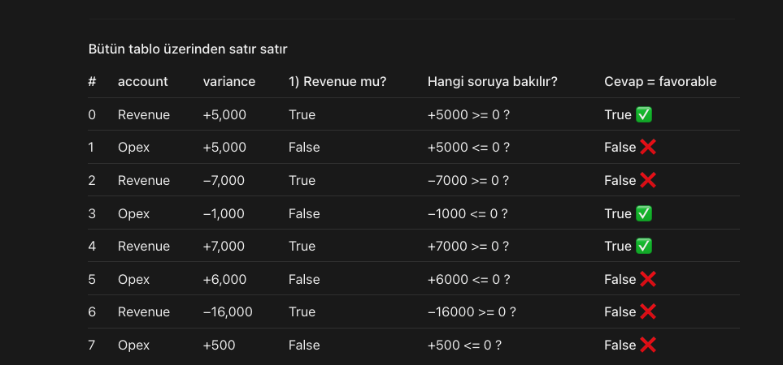
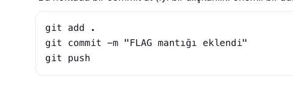

What did I learned:
a) numpy da "Where" function tam olarak if gibi calisiyor.. 
============
source .venv/bin/activate
============

Bugün öğrendiğin önemli dersler:

and yerine &, not yerine ~
Her koşulu parantez içine almak
Hata vermeyen ama yanlış sonuç üreten koda dikkat etmek ve sonucu her zaman doğrulamak

git add .
git commit -m "FLAG mantığı eklendi"
git push

Today's ozet (Nov 9)

Bugünün özeti

Öğrendiklerin: Path ile dosya yolları · agg ile çoklu hesaplama · pd.DataFrame ve pd.concat · Series ile DataFrame farkı · Mask ile filtreleme · .loc / .iloc · pivot_table · Fonksiyon açıklama pencerelerini okumak · git pull, fetch, merge, --amend, --force-with-lease · Markdown

## Veri kontrol rutini (her yeni dosyada)
df.head()                  # 1. Nasıl görünüyor?
df.info()                  # 2. Tipler doğru mu?
df.isna().sum()            # 3. Boş değer var mı?
df.duplicated().sum()      # 4. Tekrar var mı?
df["sütun"].unique()       # 5. Metinler tutarlı mı?

# --- TEMİZLİK ---

# Region ve account: boşlukları sil, ilk harfi büyük yap
df["region"] = df["region"].str.strip().str.title()
df["account"] = df["account"].str.strip().str.title()

print(df["region"].unique())
print(df["account"].unique())

# Tekrarlanan satırları sil
print("Önce satır sayısı:", len(df))
df = df.drop_duplicates()
print("Sonra satır sayısı:", len(df))
print("Toplam actual:", df["actual"].sum())